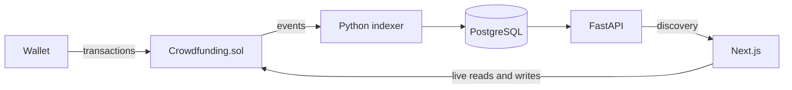

# FundChain

FundChain is a portfolio-focused decentralized ERC-20 crowdfunding platform. Creators launch immutable campaigns with optional reward tiers; supporters pledge approved tokens; the contract alone permits a successful creator claim or failed-campaign supporter refunds after the deadline.

> FundChain has extensive automated tests but has not received an independent professional audit and is not production-ready.

## Features

- Immutable campaign token, goal, deadline, creator, metadata, and reward tiers
- Trusted-token deployment policy with no administrator withdrawal path
- Exact-deadline settlement, single creator claim, and per-supporter refunds
- Responsive Next.js interface with RainbowKit, wagmi, viem, and receipt-aware states
- Searchable finalized-event API with pagination, status filters, activity, and user history
- Idempotent event indexing, confirmation depth, safe restart, reorganization recovery, and freshness reporting
- Successful and failed lifecycle E2E coverage against real contracts on Anvil

## Architecture



See [`docs/architecture.md`](docs/architecture.md) for data flow and authority boundaries.

## Technology

- Solidity 0.8.24, Foundry, OpenZeppelin 5.4
- Next.js 16, React 19, TypeScript, Tailwind CSS, Radix/shadcn-style UI
- wagmi, viem, RainbowKit, TanStack Query, Zod
- Python 3.11, FastAPI, SQLAlchemy, Alembic, web3.py, Pydantic
- PostgreSQL, pytest, Vitest, Foundry fuzz and invariant testing

## Repository

- [`packages/contracts`](packages/contracts) — escrow contract, mock token, scripts, unit/fuzz/invariant tests
- [`apps/web`](apps/web) — wallet UI, backend discovery adapter, authoritative contract hooks
- [`apps/api`](apps/api) — public read API, PostgreSQL schema, indexer, recovery and E2E tests
- [`docs`](docs) — architecture, security, deployment, testing, and demo walkthrough

## Reproducible local setup

Prerequisites: Foundry, Python 3.11+, `uv`, Node.js, pnpm, and PostgreSQL 17. Docker is optional if PostgreSQL is installed another way.

1. Start PostgreSQL:

```sh
cd apps/api
docker compose up -d postgres
```

2. Start Anvil in a separate terminal:

```sh
anvil
```

3. Use a development key printed by that isolated Anvil process, deploy, and derive matching untracked configuration:

```sh
export DEPLOYER_PRIVATE_KEY=<isolated-anvil-key>
cd packages/contracts
forge script script/DeployLocal.s.sol:DeployLocal \
  --rpc-url http://127.0.0.1:8545 --broadcast
cd ../..
python3 scripts/configure-local.py
```

4. Migrate and run backend processes in separate terminals:

```sh
cd apps/api
uv sync --dev
uv run alembic upgrade head
uv run python -m fundchain.indexer.worker
```

```sh
cd apps/api
uv run uvicorn fundchain.main:app --host 127.0.0.1 --port 8000
```

5. Run the frontend:

```sh
cd apps/web
pnpm install
pnpm dev
```

6. Configure an isolated wallet network with RPC `http://127.0.0.1:8545` and chain ID `31337`. Import only an Anvil development account. Never use that account on a public network.

Generated `apps/api/.env` and `apps/web/.env.local` files are Git-ignored. No private key is written by the configuration helper.

Detailed lifecycle exercises and testnet instructions are in [`docs/deployment.md`](docs/deployment.md).

## Quality gates

```sh
cd packages/contracts && forge fmt --check && forge build && forge test
cd apps/web && pnpm lint && pnpm typecheck && pnpm test && pnpm build
cd apps/api && uv run ruff format --check . && uv run ruff check . && uv run mypy src && uv run pytest -q
cd apps/api && RUN_ANVIL_TESTS=1 uv run pytest -q tests/integration/test_anvil_indexer.py
cd apps/api && RUN_E2E_TESTS=1 uv run pytest -q tests/e2e/test_local_lifecycles.py
```

See [`docs/testing.md`](docs/testing.md) for coverage and interpretation.

The verification results recorded there are from the 2026-10-16 local QA run; the only unexecuted gate was applying Alembic to a live PostgreSQL server because this environment has no PostgreSQL server or Docker daemon.

## Public deployment status

No Sepolia or mainnet deployment is claimed. Prompt 5 had no approved dedicated funded testnet wallet or RPC credential, so no public addresses, transaction hashes, or explorer links exist. The chain-validated Sepolia workflow and source-verification process are documented in [`docs/deployment.md`](docs/deployment.md).

## Security and limitations

- The contract is authoritative; indexed data is eventually consistent and never grants authorization.
- Only reviewed, conventional non-rebasing and non-fee ERC-20 behavior is supported.
- Reward fulfillment and metadata availability remain off-chain.
- Direct token transfers are unattributed and unrecoverable.
- In-memory API rate limiting is single-process only.
- Deep reorganizations require operator-directed resynchronization.
- PostgreSQL backup/restore, load, browser-matrix, and public testnet validation remain future work.

See [`docs/security-review.md`](docs/security-review.md) for controls, residual risks, and pre-production requirements.

## Future improvements

Independent contract audit, formal properties, shared Redis rate limiting, production observability, PostgreSQL full-text search, dedicated indexer API integration throughout the dashboard, IPFS metadata pinning, multi-token deployment manifests, browser E2E automation, and a separately authorized Sepolia release.

## Portfolio demonstration

Use the concise synthetic-data script in [`docs/demo-walkthrough.md`](docs/demo-walkthrough.md). Never display secrets or represent local transactions as public testnet evidence.
