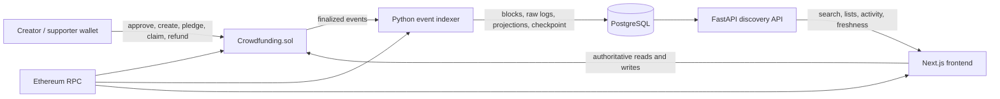

# FundChain architecture

## Authority boundaries

The Solidity contract is the only financial authority. The frontend verifies live campaign state before exposing settlement actions and submits transactions through the connected wallet. The backend never signs transactions, holds private keys, or authorizes claims.

The API is a finalized-event discovery projection. Campaign lists, text search, activity, and user history come from PostgreSQL and include index freshness metadata. Campaign detail, allowance, pledges, creator claims, and refunds are checked directly against the configured contract.

## End-to-end data flow

1. A wallet on the configured chain calls `createCampaign`.
2. The contract validates immutable terms and emits tier events followed by `CampaignCreated`.
3. The indexer reads only blocks at or below the safe head, persists canonical block hashes and unique logs, and updates projections atomically.
4. FastAPI returns the searchable campaign with finalized-block metadata.
5. A supporter approves the campaign token and submits `pledge`; the frontend waits for a successful receipt before refetching contract state.
6. `Pledged` is indexed idempotently and updates gross campaign/supporter totals.
7. At the exact deadline, pledging closes. Successful creators may claim once; failed supporters may refund their own recorded pledge once.
8. `FundsClaimed` and `Refunded` update indexed history but never grant authorization.

## Consistency and reorganizations

The frontend can show a newly confirmed transaction before the backend indexes it because the API intentionally waits for confirmation depth. It labels stale/incomplete index data. The indexer verifies checkpoint hashes, searches backward for a common ancestor after a mismatch, removes orphaned records, rebuilds all projections from retained logs, and resumes replay. Deep reorganizations require an explicit operator resync.

## Package map

- `packages/contracts`: Solidity escrow, mocks, Foundry tests, deployment scripts.
- `apps/api`: FastAPI, SQLAlchemy models, Alembic, event indexer, API and E2E tests.
- `apps/web`: Next.js App Router UI, typed ABI, wallet and contract hooks, backend discovery adapter.
- `scripts/configure-local.py`: derives untracked local API/web environment files from a real deployment receipt.
